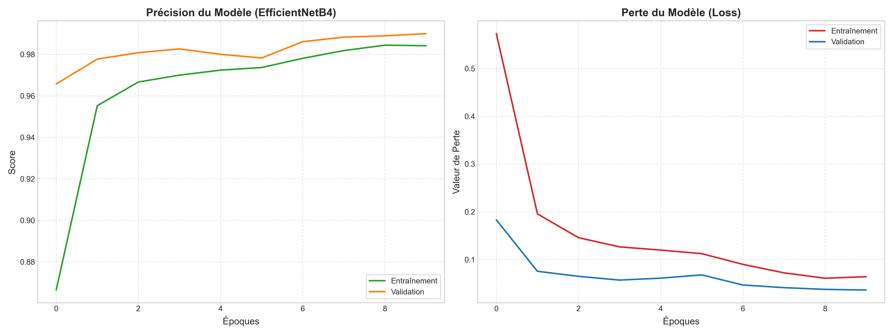
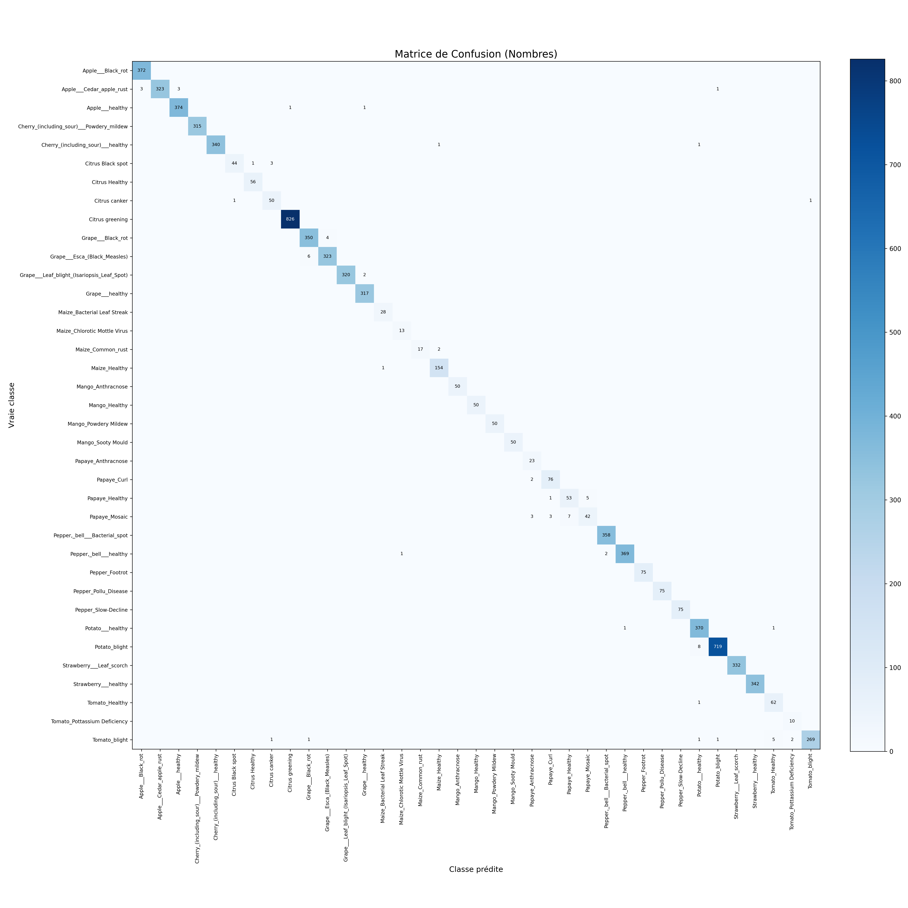

# Agri Alert — Diagnostic des maladies des plantes par Deep Learning

  

## Description

Agri Alert est un outil d'aide à la décision pour les agriculteurs : à partir d'une photo de feuille, il identifie la maladie de la plante et propose un traitement adapté.

Ce dépôt contient la partie Machine Learning : l'entraînement du modèle et l'API de prédiction. Le projet complet comprend aussi :
- [Backend_AgriAlert](https://github.com/realxane/Backend_AgriAlert) : API Laravel (utilisateurs, historique) ;
- [Frontend_AgriAlert](https://github.com/realxane/Frontend_AgriAlert) : application mobile Flutter.

## Modèle

- **Architecture** : EfficientNetB4 pré-entraîné sur ImageNet (images 380 × 380), apprentissage par transfert en deux phases :
  1. entraînement de la tête de classification, base gelée (7 époques, taux d'apprentissage 1e-3) ;
  2. fine-tuning des 30 dernières couches, BatchNormalization gelées (3 époques, taux d'apprentissage 1e-5).
- **Déséquilibre des classes** : pondération des classes (class weights) calculée à partir du nombre d'images par classe.
- **Augmentation de données** : retournement horizontal, rotation (±8 %) et zoom (±10 %).
- **Données** : [nom du jeu de données, source], [N] images réparties en 37 classes, découpées en 70 % entraînement, 15 % validation, 15 % test.

## Résultats

Évaluation sur [N] images de test, jamais vues pendant l'entraînement :

| Métrique | Valeur |
| --- | --- |
| Exactitude (accuracy) | 99.05 % |
| F1-score (moyenne macro) | 97.56 % |




## Organisation du code

| Fichier | Rôle |
| --- | --- |
| `train.py` | Entraînement complet (phase 1 + fine-tuning) |
| `finetuning_only.py` | Reprise du fine-tuning à partir d'un modèle sauvegardé |
| `evaluate.py` | Évaluation sur le jeu de test : exactitude, rapport par classe, F1 |
| `matrice.py` / `courbe.py` | Matrice de confusion et courbes d'entraînement |
| `predict.py` | Prédiction sur une image isolée |
| `app.py` | API REST Flask (`POST /predict`) : maladie détectée, confiance et traitement recommandé |

## Lancement local

Le modèle entraîné (`plant_disease_final_model.keras`) est disponible ici [https://drive.google.com/drive/folders/1_p-oxv8p93n1NRHo3g71iSH0cDeZ2AqE?usp=drive_link](lien-drive). Placez-le à la racine du projet, puis :

```bash
pip install -r requirements.txt
python app.py
```

## Limites et pistes d'amélioration

- Les images d'entraînement sont prises [en conditions contrôlées / sur fond uni] : les performances sur des photos de terrain au Mali restent à valider.
- Pistes : enrichir le jeu de données avec des cultures locales (mil, sorgho, coton), et alléger le modèle pour une utilisation hors ligne sur téléphone.